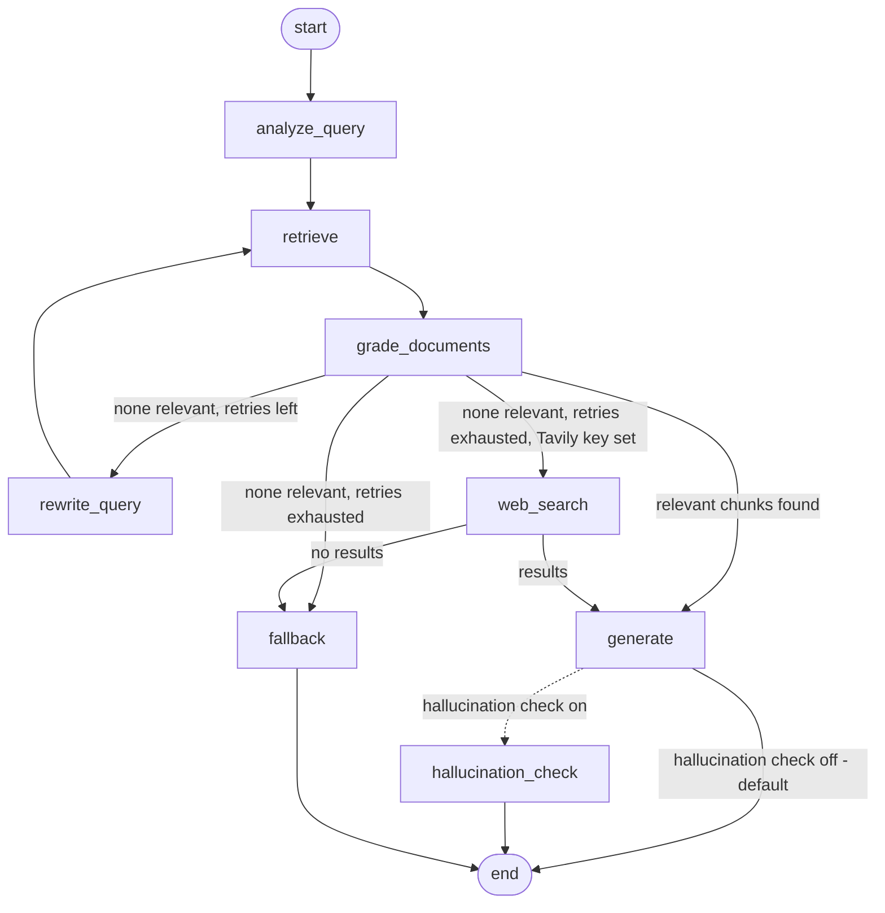

# RAG-Based Technical Documentation Assistant

A Retrieval-Augmented Generation assistant with a **self-corrective LangGraph workflow**, served through **FastAPI**. It answers questions about FastAPI and Pydantic documentation, cites the sources it used, and says "I don't know" instead of guessing when the documentation does not contain the answer.

- **Corpus:** 6 official documentation pages (FastAPI: path parameters, request body, dependencies, background tasks; Pydantic: models, validators), indexed as 207 chunks.
- **Stack:** Python 3.12, LangGraph, FastAPI, ChromaDB, local `sentence-transformers` embeddings, Gemini (Flash) as the LLM.
- **Bonus features built:** hallucination check, Tavily web-search fallback, conversation memory, Gradio UI. See "Verification status" below for what was tested live and what was not.

---

## 1. How it works

### Workflow



`docs/graph.md` holds the diagram generated from the compiled graph at startup (it reflects whichever feature flags are on).

### Nodes

| Node | What it does |
|------|--------------|
| `analyze_query` | One structured-output LLM call: classifies the question (`conceptual`, `how-to`, `troubleshooting`, `api_reference`) and rewrites it into a self-contained search query. Uses chat history to resolve follow-ups. Also resets all per-turn state. |
| `retrieve` | Similarity search in ChromaDB, top-k chunks (default 5) with source metadata. |
| `grade_documents` | One structured-output LLM call returns a relevant/irrelevant verdict **for every chunk**. Irrelevant chunks are dropped. This is the self-corrective check. |
| `rewrite_query` | When nothing is relevant: writes a *different* query (it is shown all failed queries), increments `retry_count`, loops back to `retrieve`. |
| `generate` | Answers using only the relevant chunks, with `[n]` citations. Answer style depends on `query_type`. Only sources the answer actually cites are returned, renumbered to match. Saves the turn to chat history. |
| `fallback` | Clear "not found in the documentation" message when retries are exhausted. Makes no claims. |
| `web_search` (bonus) | Tavily search when the vector store has nothing relevant after the retries. Skipped if no key is set. |
| `hallucination_check` (bonus) | Verifies the answer is supported by the context; regenerates once with a stricter prompt and re-verifies. |

### Routing (the conditional edge, `app/graph/edges.py`)

After `grade_documents`: relevant chunks → `generate`; otherwise `retry_count < max_retries` → `rewrite_query`; otherwise `web_search` (if a Tavily key is set) or `fallback`. The routing functions are pure (state in, node name out), so they are unit-tested without an LLM, including the boundary at the retry limit.

### State schema (`app/graph/state.py`)

| Field | Purpose |
|-------|---------|
| `question` | Original question. Never overwritten. |
| `rewritten_query` | Query currently used for retrieval; replaced on each retry. |
| `query_type` | Classified intent. |
| `documents` / `relevant_documents` / `grades` | Retrieved chunks, chunks that passed grading, and a per-chunk verdict with reason. |
| `retry_count`, `max_retries` | Retry tracking. The loop ends when `retry_count >= max_retries`. |
| `failed_queries` | Queries that retrieved nothing relevant; shown to the rewrite prompt so it does not repeat itself. |
| `answer`, `citations`, `status` | Output. `status` is `answered`, `insufficient_context` or `fallback`. |
| `grounded`, `used_web_search` | Bonus flags (`grounded` is `null` when the check is off). |
| `chat_history` | Prior turns, kept per `session_id` by LangGraph's `MemorySaver`. |
| `trace` | Nodes visited, returned by the API for transparency. |

---

## 2. Setup

**Requirements:** Python **3.12** (3.13 can fail on some dependencies) and a free Gemini API key from [Google AI Studio](https://aistudio.google.com/app/apikey). Optional: a [Tavily](https://tavily.com) key for web search.

```bash
python -m venv venv
venv\Scripts\activate          # Windows   (macOS/Linux: source venv/bin/activate)
pip install -r requirements.txt
copy .env.example .env         # macOS/Linux: cp .env.example .env
```

Edit `.env` and set `GOOGLE_API_KEY`. If you get a 404 "model not found", set `LLM_MODEL` to a current Gemini Flash model name from AI Studio. Run every command from the project root, because that is where `.env` is read.

| Variable | Default | Meaning |
|----------|---------|---------|
| `GOOGLE_API_KEY` | – | Required |
| `LLM_MODEL` | `gemini-2.5-flash` | Any Gemini model (other providers: edit `app/llm.py`) |
| `MAX_RETRIES` | `2` | Query-rewrite retries before fallback |
| `RETRIEVAL_TOP_K` | `5` | Chunks retrieved per search |
| `ENABLE_HALLUCINATION_CHECK` | `false` | Adds the verification node (restart required) |
| `TAVILY_API_KEY` | empty | Enables web-search fallback |
| `LLM_TIMEOUT` | `30` | Seconds per LLM request |

## 3. Run

```bash
python scripts/fetch_corpus.py   # optional: the corpus is already committed in data/corpus/
python scripts/ingest.py         # optional: the server also indexes the corpus on first start
uvicorn app.main:app --port 8000
```

Open http://localhost:8000 (redirects to the interactive Swagger docs at `/docs`). The first start downloads the embedding model and indexes the corpus, which takes a few minutes. Restart with Ctrl+C and the same command.

Optional UI: with the API running, `python ui/gradio_app.py` → http://localhost:7860.

Tests: `pytest tests/ -v` (42 tests passed on the last run; no API key needed, the LLM and vector store are faked).

---

## 4. API examples (real outputs)

All errors use one envelope, `{"error", "detail", "status_code"}`.

### `POST /query`

```bash
curl -X POST http://localhost:8000/query -H "Content-Type: application/json" \
  -d '{"question": "How do I declare path parameters in FastAPI?"}'
```

```json
{
  "query_id": "daaec158-e9b8-45f9-bf48-83932f9b70e8",
  "answer": "To declare path parameters in FastAPI, you can define them within the path string using curly braces `{}`. For example, to declare a `user_id` path parameter, you would use `/users/{user_id}` [1]. ... Note that the order of path operations matters; a fixed path like `/users/me` should be declared before a path parameter like `/users/{user_id}` [1].",
  "sources": [
    {
      "title": "FastAPI - Path Parameters",
      "source": "https://fastapi.tiangolo.com/tutorial/path-params/",
      "section": "Path Parameters > Order matters",
      "snippet": "## Order matters When creating *path operations*, you can find situations where you have a fixed path. ..."
    }
  ],
  "query_type": "how-to",
  "rewritten_query": "FastAPI how to declare and define path parameters in route operations",
  "retries_used": 0,
  "grounded": null,
  "used_web_search": false,
  "trace": ["analyze_query", "retrieve", "grade_documents", "generate"],
  "latency_ms": 15025.5
}
```
(Answer shortened here for readability.)

### Out-of-scope question: corrective retries, then a safe refusal

```bash
curl -X POST http://localhost:8000/query -H "Content-Type: application/json" \
  -d '{"question": "How do I configure Redis in Django?"}'
```

```json
{
  "query_id": "f9a7602c-92c1-4861-b39f-f38964fc0c86",
  "answer": "I don't have enough information in the indexed documentation to answer this.",
  "sources": [],
  "query_type": "how-to",
  "rewritten_query": "What are the common integration patterns for Redis in Python web frameworks?",
  "retries_used": 2,
  "grounded": null,
  "used_web_search": false,
  "trace": ["analyze_query", "retrieve", "grade_documents", "rewrite_query", "retrieve",
            "grade_documents", "rewrite_query", "retrieve", "grade_documents", "generate"],
  "latency_ms": 67088.31
}
```

This shows the corrective loop: two rewrites, then it stops at the retry limit. On the last attempt the grader let one weakly related chunk through, so the trace ends in `generate` rather than `fallback`; the generation prompt then correctly refused instead of inventing an answer. Two layers protect against hallucination (the grader, then the generation prompt). The long latency comes from the Gemini free tier's rate limit (see Known limitations).

### `GET /documents`

```json
{
  "total": 6,
  "documents": [
    {"doc_id": "fastapi_background_tasks", "title": "FastAPI - Background Tasks",
     "source": "https://fastapi.tiangolo.com/tutorial/background-tasks/", "chunk_count": 11},
    {"doc_id": "fastapi_dependencies", "title": "FastAPI - Dependencies",
     "source": "https://fastapi.tiangolo.com/tutorial/dependencies/", "chunk_count": 21},
    {"doc_id": "fastapi_path_parameters", "title": "FastAPI - Path Parameters",
     "source": "https://fastapi.tiangolo.com/tutorial/path-params/", "chunk_count": 22},
    {"doc_id": "fastapi_request_body", "title": "FastAPI - Request Body",
     "source": "https://fastapi.tiangolo.com/tutorial/body/", "chunk_count": 16},
    {"doc_id": "pydantic_models", "title": "Pydantic - Models",
     "source": "https://docs.pydantic.dev/latest/concepts/models/", "chunk_count": 96},
    {"doc_id": "pydantic_validators", "title": "Pydantic - Validators",
     "source": "https://docs.pydantic.dev/latest/concepts/validators/", "chunk_count": 41}
  ]
}
```

### `POST /feedback`

```bash
curl -X POST http://localhost:8000/feedback -H "Content-Type: application/json" \
  -d '{"query_id": "daaec158-e9b8-45f9-bf48-83932f9b70e8", "rating": "up", "comment": "Good answer"}'
```
```json
{"status": "accepted", "query_id": "daaec158-e9b8-45f9-bf48-83932f9b70e8"}
```
An unknown `query_id` returns `404`. Feedback is appended to `data/feedback.jsonl`, and every answered query is logged in `data/queries.jsonl`, so feedback keeps working after a server restart.

### `POST /ingest`

```bash
# file upload (use curl.exe on Windows PowerShell)
curl -X POST http://localhost:8000/ingest -F "files=@test_doc.md"

# or URLs
curl -X POST http://localhost:8000/ingest -H "Content-Type: application/json" \
  -d '{"urls": ["https://fastapi.tiangolo.com/tutorial/query-params/"]}'
```
```json
{"documents_ingested": 1, "chunks_ingested": 1, "doc_ids": ["test_doc"]}
```
Tested with a two-sentence `test_doc.md`: `/documents` then listed 7 documents, with `test_doc` as a 1-chunk document. Swagger's "Try it out" cannot send file uploads to this endpoint, so use curl for it.

### Error codes

`422` invalid input (blank or >1000-character question, malformed JSON, bad rating), `400` unsupported file type, unsupported content type, or bad or blocked URL, `404` unknown `query_id`, `413` file over 10 MB, `503` LLM or vector store unavailable or misconfigured.

---

## 5. Verification status

| Area | Status |
|------|--------|
| Graph (retry then success, fallback after retry limit, happy path, citation filtering, chat memory), routing, chunking, API validation, query log | Unit-tested, 42 tests pass (fake LLM) |
| `/query` happy path, out-of-scope retry loop, `/documents`, `/feedback`, `/ingest` (file) | Run live against Gemini |
| URL ingestion, web-search fallback, hallucination check | Implemented; not run live (covered only by code review and routing tests) |
| Gradio UI | Implemented; not verified in final testing |

---

## 6. Design decisions and trade-offs

**Why LangGraph.** The assignment needs a loop with a retry limit and a routing decision. A graph with explicit state makes both visible and testable: routing is a pure function, and the graph test asserts `retry_count` and the exact node trace.

**Chunking.** Two stages: split on Markdown headings first (so a chunk stays on one topic and carries a section breadcrumb such as `Path Parameters > Order matters`), then split long sections into ~900 characters with 150 overlap. 900 characters keeps each chunk well inside the embedding model's input size while holding enough text to be useful on its own. Code fences are used as a preferred split point, so code blocks are *usually* kept whole, but not guaranteed. Chunks under 30 characters (heading-only) are dropped. Chunk IDs are a hash of `doc_id + index`, and re-ingesting a document first deletes its old chunks, so ingestion is idempotent and leaves no stale chunks. The corpus fetcher also inlines FastAPI's code examples, which the raw docs only reference by include directive.

**Embeddings.** `all-MiniLM-L6-v2` runs locally, so there is no second API key and no extra cost. The trade-off is lower quality than a hosted embedding model on technical text.

**Grading all chunks in one call.** The first version made one LLM call per chunk (7 calls per question), which immediately hit Gemini's free-tier limit of 5 requests per minute. Now one structured call returns a verdict for each chunk id, so a normal question costs 3 calls. The verdict is still per chunk. The trade-off is that the model sees all chunks at once, so verdicts can influence each other, and each chunk is truncated to 1200 characters in the grading prompt.

**Retry limit of 2.** A judgment call, not measured: a few different phrasings are usually enough to find content that exists, and every extra retry costs latency and API quota. It is configurable (`MAX_RETRIES`).

**Structured outputs.** Query analysis and grading use Pydantic schemas, so the code never parses free-text LLM output. `query_type` is a `Literal`, so invalid labels are rejected.

**Citations come from the answer, not the retrieval.** The answer's `[n]` markers decide which sources are returned, and markers are renumbered so `[1]` is always the first source listed. A regex ignores code such as `items[1]`.

**LLM retries.** Only transient errors (rate limit, timeout, 5xx) are retried, honouring the provider's "retry in Ns" hint. Bad keys or model names fail immediately and become a clear `503`.

**Session memory.** LangGraph's in-memory `MemorySaver`, keyed by `session_id`. Simple and dependency-free, but lost on restart.

---

## 7. Assumptions

- The corpus is the six pages in `scripts/fetch_corpus.py`; other topics should end in a refusal or the fallback.
- English only.
- The Gemini free tier is enough for a demo; `session_id` is supplied by the client and not validated beyond its length.

## 8. What I would improve with more time

- Hybrid BM25 + vector retrieval and a cross-encoder reranker (exact names like `model_validator` are weak spots for dense embeddings).
- Constrain query rewriting to keep key entities; in the Redis example the rewrite drifted from "Django" to generic "Python web frameworks".
- Evaluation with RAGAS (faithfulness, context recall) on a labelled question set.
- Streaming responses, auth and rate limiting, persistent sessions (SQLite checkpointer), background ingestion, Docker.
- Use the Chroma public API instead of the private `_collection` attribute.

## 9. Known limitations

- **Free-tier rate limits.** The Gemini free tier allows about 5 requests per minute. A question that retries makes up to ~6 calls, so it can take 30–70 seconds (the Redis example took 67 s). A paid key or a higher-limit model removes this.
- **Answer quality depends on retrieval.** For the path-parameters question the answer cited only the "Order matters" section; the basic declaration section would be a better primary source. Increasing `RETRIEVAL_TOP_K` may help.
- **Grader leniency.** A weakly related chunk can pass grading, so a refusal may come from `generate` instead of `fallback`.
- **Code blocks** are only preferentially kept intact.
- **Sessions are in memory** and lost on restart (query IDs and feedback are persisted).
- **`/ingest` URL fetching** blocks private and loopback addresses and caps response size, but is not a complete SSRF defence (for example, DNS rebinding). One bad item fails the whole request.
- **No authentication** on the API.
- **Dependencies are not pinned to exact versions** (older pins required a C++ compiler on Windows); a lock file would make builds reproducible.
- **Tests use a fake LLM**, so they cover routing, state handling, citations and memory, but not real model quality.

## 10. Sample questions

| Type | Question | Observed |
|------|----------|----------|
| Answerable | How do I declare path parameters in FastAPI? | Answered with a cited source, no retries |
| Out of scope | How do I configure Redis in Django? | 2 retries, then a refusal with no sources |

## 11. Project structure

```
app/            main.py, config.py, schemas.py, llm.py, vectorstore.py, store.py
app/api/        query.py, ingest.py, documents.py, feedback.py
app/graph/      state.py, nodes.py, edges.py, builder.py, prompts.py, prompts_batch.py
app/ingestion/  loaders.py, chunking.py, pipeline.py
scripts/        fetch_corpus.py, ingest.py
ui/             gradio_app.py
tests/          chunking, routing, graph (fake LLM), API, store
data/corpus/    the documentation corpus (committed)
docs/graph.md   graph diagram generated at startup
```
